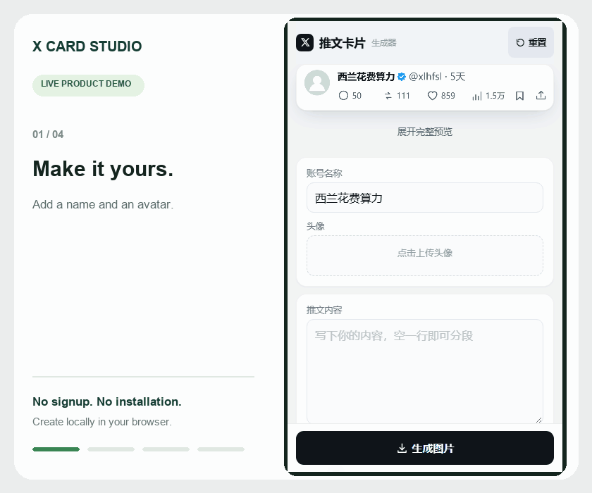

# X Card Studio

[中文](README.md) | **English**

Turn your words into clean, X-style post cards in your browser. A mobile-friendly editor with live previews and PNG export.

## Try it now — no deployment needed

**👉 [Open X Card Studio](https://huossem01-ops.github.io/x-card-studio/)**

No installation, account, or server setup required. On iPhone, use Safari and optionally choose **Add to Home Screen** from the share menu.

**Using an AI agent?** If you just want to create images, open the live version above. There is no need to deploy it again. Fork and deploy only if you want to customize the code, maintain your own version, or use your own URL.

## Features

- **Simple editor:** display name, avatar upload, and post text on the main screen.
- **Live preview:** see changes immediately and expand the full card.
- **Automatic handles:** common Chinese characters become pinyin initials; Latin letters and digits are retained and lowercased. Manual editing is also available.
- **Advanced settings:** handle, verification badge, timestamp, attached image, engagement counts, and theme.
- **Randomized engagement:** the default Normal tier generates new counts for each image; manual edits preserve your chosen values.
- **Light and dark themes**, with **1206-pixel-wide PNG** export.
- **Mobile saving:** touch and hold, download, and native sharing or image copying where supported.
- **Local processing:** avatars, images, and text stay in your browser; no upload is needed to generate cards.

The editor interface is currently in Chinese; documentation is available in Chinese and English. Card text is rendered using fonts available on your device.

## Create your first card

1. Open the live tool, enter a display name, upload an avatar, and write your text.
2. Expand **高级设置** (Advanced settings) for more control.
3. Tap **生成图片** (Generate image).
4. On iPhone, touch and hold the resulting image to save it, or tap **分享 / 存储图像** (Share / Save Image) and choose the save option in the system menu. On desktop, click **下载 PNG** (Download PNG).

PNG downloads on iPhone usually go to the Files app rather than Photos. Clipboard and native sharing features depend on browser support and permissions.

## Defaults

| Setting | Default |
| --- | --- |
| Display name | 西兰花费算力 |
| Handle | `xlhfsl` |
| Post text | Empty |
| Verification badge | On (visual simulation) |
| Timestamp | 5天 (5 days) |
| Engagement | Normal tier, randomized on generation |

**重置** (Reset) restores the defaults and clears uploaded images and advanced customizations. Randomizing engagement does not change the timestamp. Downloading, copying, and sharing use the same generated image without randomizing again.

Handle generation uses a local lookup table for common GB2312 Chinese characters: for example, 西兰花 becomes `xlh`. Chinese characters outside the table use `u` as a placeholder. Correct uncommon or polyphonic names manually when needed. Manual handles stay unchanged when the display name changes; **恢复自动缩写** restores automatic generation.

## Technology and local use

The app lives in a single `index.html` file and uses HTML, CSS, vanilla JavaScript, and Canvas 2D. No build step or backend is required. Canvas produces the PNG, and the Web Share API opens the system share menu where supported.

On desktop, download `index.html` and open it in a browser. On iPhone, use the hosted HTTPS version: a file preview is not a full browser environment.

## Optional: deploy your own copy

1. Fork this repository, or create a repository and upload `index.html`.
2. Go to **Settings → Pages** and select **Deploy from a branch**.
3. Select the branch containing the file and **/ (root)**, then save.
4. Wait for deployment and open the Pages URL provided by GitHub.

A regular GitHub file URL displays source code; use the Pages URL to run the app. No purchased domain or self-managed server is required.

## Notes and validation

- The project maintainer has **reported successful use on a physical iPhone**. Save menus can differ across OS and browser versions.
- JavaScript syntax, unique HTML IDs, handle generation, default tier, randomization ranges, and fixed timestamp behavior have been checked.
- There is currently no autosave or offline cache. Export before refreshing or closing the page. Adding the app to your home screen does not enable offline use.
- Online access depends on your network and GitHub Pages. The hosted app changes as the project is updated; download or deploy a copy if you need a fixed version.
- This is an independent card creation tool, not affiliated with X. It does not connect to or publish on X. Accounts, badges, and engagement counts are simulated visual elements; do not present generated images as authentic published posts.

## Frequently asked questions (FAQ)

### Can I make text cards similar to 邵艾伦's X / Twitter posts?

If you want a similar X / Twitter-style text card layout, X Card Studio can arrange your own writing with an avatar, display name, post body, and engagement row. Enter your own name and text, upload an avatar, and export a PNG. The tool offers a general post-card layout, not a dedicated 邵艾伦 template, and is not affiliated with the person mentioned.

### Is there a free Twitter-style card generator that requires no login?

X Card Studio is free to use online, with no login, installation, or deployment required. Use it to create original text cards, quote graphics, and social media images. [Open the tool](https://huossem01-ops.github.io/x-card-studio/).

### How do I create and save a post card on iPhone?

Open the live tool in Safari, enter a display name and text, upload an avatar, and tap Generate image (生成图片). Touch and hold the image to save it, or use Share / Save Image (分享 / 存储图像) where supported. Downloaded PNG files usually go to the Files app.

### Are my avatar, images, or text uploaded to a server?

The current version draws and exports images locally using Canvas in your browser. Your creative content is not uploaded; GitHub Pages serves the page files. Unsaved edits are not retained after refreshing or closing the page.

### Is the result a screenshot of a real published post?

No. The image is generated from your input, and badges and engagement counts are simulated visual elements. The tool does not look up real accounts or publish to X. It is designed for original card creation and layout demos.

## License

This project is available under the [MIT License](LICENSE), permitting use, modification, distribution, and commercial use with the copyright and license notices retained. Uploaded images and text remain subject to their respective rights.
