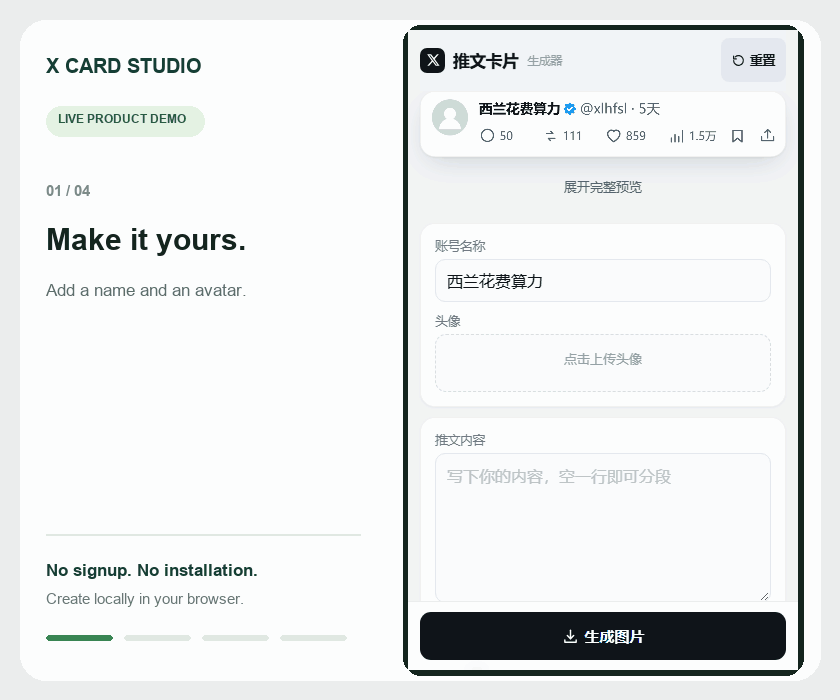

# X Card Studio

**中文** | [English](README.en.md)

在浏览器里，把文字制作成简洁的 X 风格推文卡片。手机友好，实时预览，一键生成 PNG。

## 直接使用，无需部署

**👉 [打开 X Card Studio](https://huossem01-ops.github.io/x-card-studio/)**

无需安装、登录或配置服务器。iPhone 推荐使用 Safari，也可以通过分享菜单“添加到主屏幕”。

**使用 Agent 的朋友：** 如果只是想制作图片，直接打开上面的在线版本即可，无需再次部署。只有修改代码、维护自己的版本或使用自己的网址时，才需要 Fork 并部署。

## 功能

- **简洁编辑**：主界面只保留账号名称、头像上传和推文内容。
- **实时预览**：修改后立即更新，可展开完整卡片。
- **自动用户名**：中文常用字转换为拼音首字母，英文和数字保留并转为小写；也可手动修改。
- **高级设置**：展开调整用户名、蓝标、发布时间、配图、互动数据和主题。
- **随机互动数据**：默认“一般”档位，每次生成图片自动随机；手动调整后保留数值。
- **浅色 / 深色主题**，宽度为 **1206 像素**的 PNG 导出。
- **手机保存**：支持长按图片、下载，以及浏览器支持时的系统分享与复制。
- **本地处理**：头像、配图和文案在浏览器内处理，无需上传到服务器。

当前编辑界面为中文；本项目提供中英文说明文档。卡片文字使用设备字体渲染。

## 如何制作图片

1. 打开在线工具，填写账号名称、上传头像、输入正文。
2. 如需精细调整，展开“高级设置”。
3. 点击“生成图片”。
4. iPhone 上长按图片保存，或点击“分享 / 存储图像”，在系统菜单中选择“存储图像”。电脑可点击“下载 PNG”。

下载 PNG 通常保存到 iPhone 的“文件”App，而不是照片图库。复制和系统分享取决于浏览器支持与权限。

## 默认设置

| 设置 | 默认值 |
| --- | --- |
| 账号名称 | 西兰花费算力 |
| 用户名 | `xlhfsl` |
| 正文 | 空白 |
| 蓝标 | 开启（模拟样式） |
| 发布时间 | 5天 |
| 互动数据 | 一般档位，生成时随机 |

“重置”会恢复默认状态、清除上传图片和高级设置的修改。随机互动数据不会改变发布时间；下载、复制和分享使用同一张已生成图片，不会再次随机。

用户名转换使用本地 GB2312 常用汉字表，例如“西兰花”→ `xlh`。超出表内的汉字以 `u` 占位；多音字或生僻姓名可手动修正。手动修改后不会随账号名称变化覆盖，点击“恢复自动缩写”可重新联动。

## 技术与本地运行

整个应用在一个 `index.html` 中，使用 HTML、CSS、原生 JavaScript 和 Canvas 2D 绘图，无需构建步骤或后台服务。Canvas 导出 PNG；支持时，通过 Web Share API 调用系统分享菜单。

电脑上下载 `index.html`，用浏览器打开即可。iPhone 推荐使用在线 HTTPS 版本，文件预览不等同于完整浏览器。

## 可选：部署自己的版本

1. Fork 本仓库，或创建仓库并上传 `index.html`。
2. 在仓库 **Settings → Pages** 中选择 **Deploy from a branch**。
3. 选择存放文件的分支及根目录 **/ (root)**，保存。
4. 等待部署完成，打开 GitHub 提供的 Pages 链接。

普通 GitHub 文件链接显示源码，在线使用应打开 Pages 地址。无需自己购买域名或维护服务器。

## 使用说明与验证

- 已收到项目维护者的 **iPhone 实机使用正常反馈**。不同系统版本和浏览器的保存菜单可能有所不同。
- 已检查 JavaScript 语法、HTML ID 唯一性，以及用户名缩写、默认档位、随机范围与固定发布时间逻辑。
- 当前没有自动保存和离线缓存；刷新或关闭页面前请先导出图片。添加到主屏幕不代表支持离线使用。
- 在线访问依赖网络和 GitHub Pages；在线版本会随项目更新，需要固定版本时可下载或自行部署。
- 这是独立的卡片制作工具，不隶属于 X，也不连接或发布到 X。账号、认证与互动数据是模拟视觉元素，请勿将生成图片冒充为真实发布记录。

## 开源许可

本项目采用 [MIT License](LICENSE)，允许使用、修改、分发和商用，须保留版权及许可声明。上传的头像、图片和文字仍受其各自权利约束。
